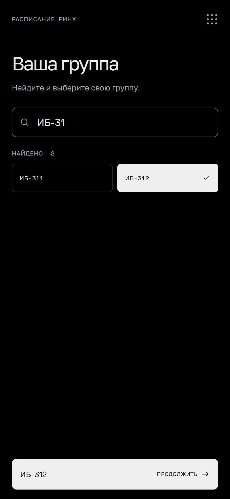
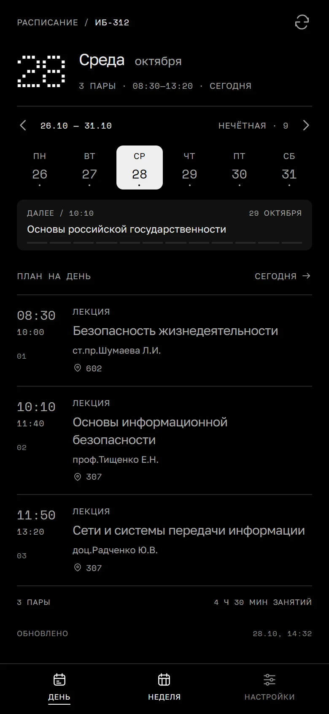
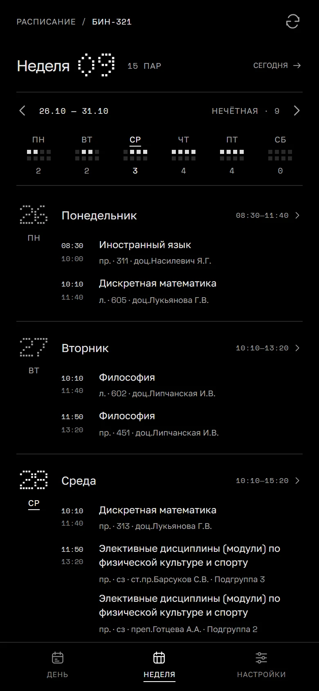
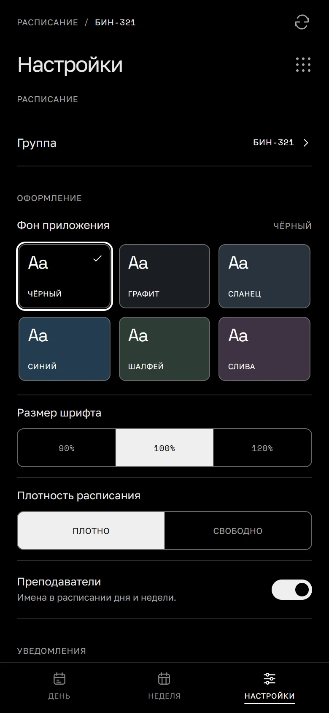

<p align="left"></p>

# Расписание РИНХ

Неофициальный минималистичный Android-клиент [расписания РГЭУ (РИНХ)](https://rasp.rsue.ru/). Расписание по дням и неделям, выбор группы и напоминания об окончании занятий. Сохранённое расписание доступно без сети.


| Выбор группы | День |
|:---:|:---:|
|  |  |
| Неделя | Настройки |
|  |  |

## Запуск

Node.js 22.12+, Rust и Android SDK/NDK (Android Studio).

```sh
npm ci
npm run dev
```

## Android

```sh
npm run android:build
```

APK создаётся в `src-tauri/gen/android/app/build/outputs/apk/universal/release/`. Подписать для установки: `npm run android:sign -- <путь-к-unsigned.apk>`.

Проверки: `npm test` · `npm run build`. Иконки: `npm run icons`.

## Лицензия

Проект лицензирован под лицензией [MIT](LICENSE).
